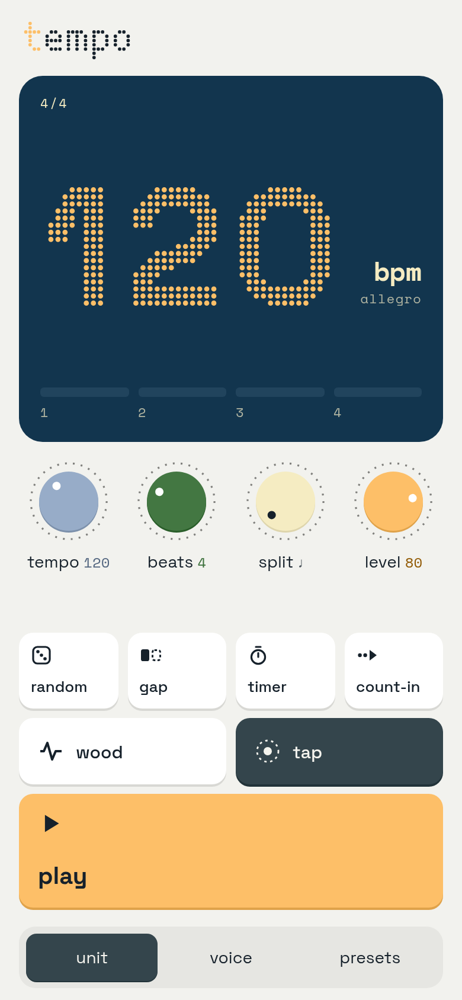
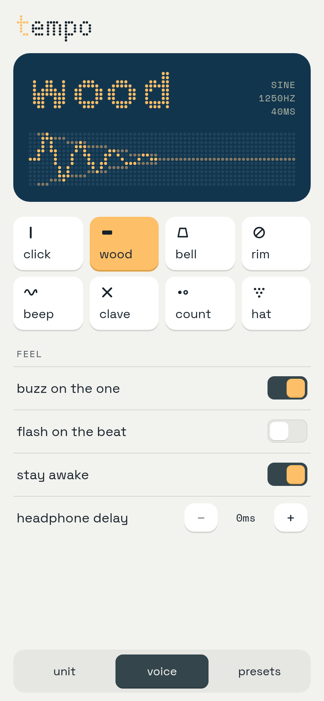

# tempo

A pocket metronome for the browser. Installable, works offline, no accounts.

**Try it: [opentempo.app](https://opentempo.app)**

<p>
  
  
</p>

## Features

- 20–300 bpm counting beats; 1–12 beats per bar, each split into 1–4 clicks, accented downbeat. Time signature quick picks (2/4 to 7/4, 6/8, 9/8, 12/8) set beats and split and show the count out loud ("1 & a 2 & a")
- Tap tempo, plus the Italian tempo marking for whatever you land on
- **random**: a new tempo within a range every N bars
- **gap**: play N bars, mute M bars, to check your inner clock
- **timer**: practice countdown that stops (or buzzes) at the end
- **count-in**: one or two bars before the click starts
- Eight synthesised sounds, each drawn as a live dot-matrix waveform
- Desktop: shown as a unit on the page; Space plays/stops, ↑/↓ nudge the tempo (Shift: 10), T taps; knobs take drags, the scroll wheel and arrow keys
- Presets: saved snapshots of tempo, beats, split and sound
- Feel: buzz on the one, flash on the beat, keep the screen awake, headphone (Bluetooth) delay
  compensation
- Lock-screen and headphone controls (play/pause, next/previous nudges the tempo by 5)
- Everything stays on the device (IndexedDB). No server, no analytics.

## Quick start

Needs Node 22.12 or newer.

```sh
npm install
npm run dev        # http://localhost:5173, also on your LAN
```

| Script | What it does |
| --- | --- |
| `npm run dev` | Vite dev server with hot reload |
| `npm test` | Vitest, once |
| `npm run test:watch` | Vitest in watch mode |
| `npm run typecheck` | `tsc --noEmit` |
| `npm run build` | typecheck, then production build and service worker into `dist/` |
| `npm run preview` | serve `dist/` locally |

### Testing on a phone

Service workers, Wake Lock and install need HTTPS (localhost is exempt). Over plain LAN http the
click works but the PWA features don't, so use an HTTPS tunnel to the dev server for the full
behaviour.

## How it works

The timing logic is pure and fully unit-tested; everything that touches the outside world sits
in thin adapters around it.

- `src/core/`: pure functions. The timeline (tempo, accents, subdivisions, count-in, gap trainer,
  random tempo, re-planning mid-play), tap tempo, presets, tempo markings, media-session maths.
- `src/audio/`: the imperative shell. A lookahead scheduler on the Web Audio clock, driven by a
  worker ticker so a busy main thread can't delay it, and the synthesised voices (oscillators and
  noise, no samples).
- `src/platform/`: device adapters for Wake Lock, Vibration, Media Session, install prompt,
  IndexedDB and capability detection. Each degrades quietly when unsupported.
- `src/app/tempo.ts` and `src/state.ts`: app state and actions in one place; screens read signals
  and call actions, nothing else touches the engine or storage.
- `src/ui/`: Solid components: dot-matrix display, knobs, sheets, icons.
- `src/screens/`: the unit, voice and presets screens and the function sheets.

Lock-screen controls need a playing media element, so while the click plays a detached `<audio>`
loops digital silence beside it. The click itself never goes through that element, so it adds no
latency or drift.

### Design tokens and glyphs

- `src/styles/tokens.css` holds the theme as CSS custom properties. Edit it directly; see
  [`scripts/sync-tokens.md`](scripts/sync-tokens.md) for where it came from.
- `src/ui/glyphs.json` holds the dot-matrix digits and letters, rasterised from Space Grotesk by
  `scripts/glyphs.py`. You only need to run it if you change the glyph sizes. It needs Python 3
  and Pillow:

  ```sh
  pip install pillow && python scripts/glyphs.py > src/ui/glyphs.json
  # or, without installing anything globally:
  uv run --no-project --with pillow python scripts/glyphs.py > src/ui/glyphs.json
  ```

- The `tempo` wordmark (`src/ui/wordmark.ts`) and the icons (`src/ui/icons.tsx`,
  `public/icon.svg`) are drawn by hand.

## Browser support

Any current Chrome, Edge, Firefox or Safari with Web Audio. Some extras depend on the device and
are shown disabled where they can't work:

- **Vibration** ("buzz on the one"): Android Chrome. iOS Safari has no Vibration API.
- **Stay awake**: needs the Screen Wake Lock API (current Chrome, Edge, Firefox and Safari).
- **Install**: Chrome and Edge show an install button. On iOS use Share → Add to Home Screen.
- **Screen locked or app in the background**: Android keeps clicking. On iOS, Safari suspended Web
  Audio in the background until 17.5; from 17.5 on the app sets `navigator.audioSession` to
  `playback`, which keeps it running and makes it play through the silent switch. Older iOS stops
  when you lock the screen.
- **Bluetooth headphones** add delay that the browser can't always report. Use *headphone delay*
  on the voice screen to line up the flash and buzz with what you hear.

## Contributing

Issues and pull requests are welcome. Please keep the core pure and tested, run
`npm run typecheck && npm test && npm run build` before opening a PR (CI runs the same), and keep
changes focused. For anything big, open an issue first so we can talk it through.

## Licence and credits

MIT, © 2026 Sepehr Sobhani. See [LICENSE](LICENSE).

- Fonts: [Space Grotesk](https://github.com/floriankarsten/space-grotesk) and
  [Space Mono](https://github.com/googlefonts/spacemono), SIL Open Font License 1.1.
- Colours: combination #294 from Sanzo Wada's *A Dictionary of Color Combinations*, via Matt
  DesLauriers' [open dataset](https://github.com/mattdesl/dictionary-of-colour-combinations).
- Built with [Solid](https://www.solidjs.com), [Vite](https://vite.dev),
  [vite-plugin-pwa](https://vite-pwa-org.netlify.app) / Workbox and
  [idb-keyval](https://github.com/jakearchibald/idb-keyval).

Full details in [THIRD_PARTY_NOTICES.md](THIRD_PARTY_NOTICES.md).
